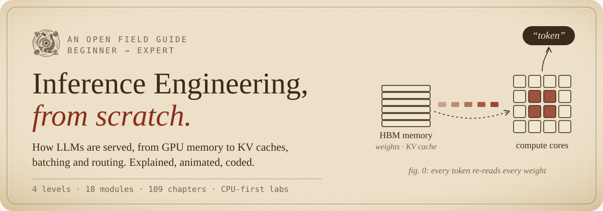
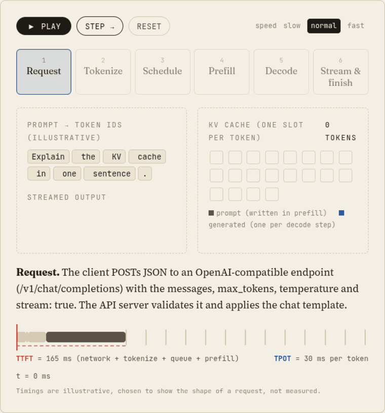
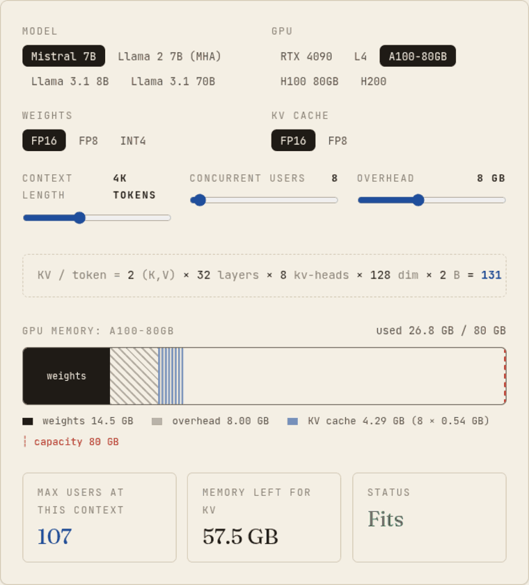
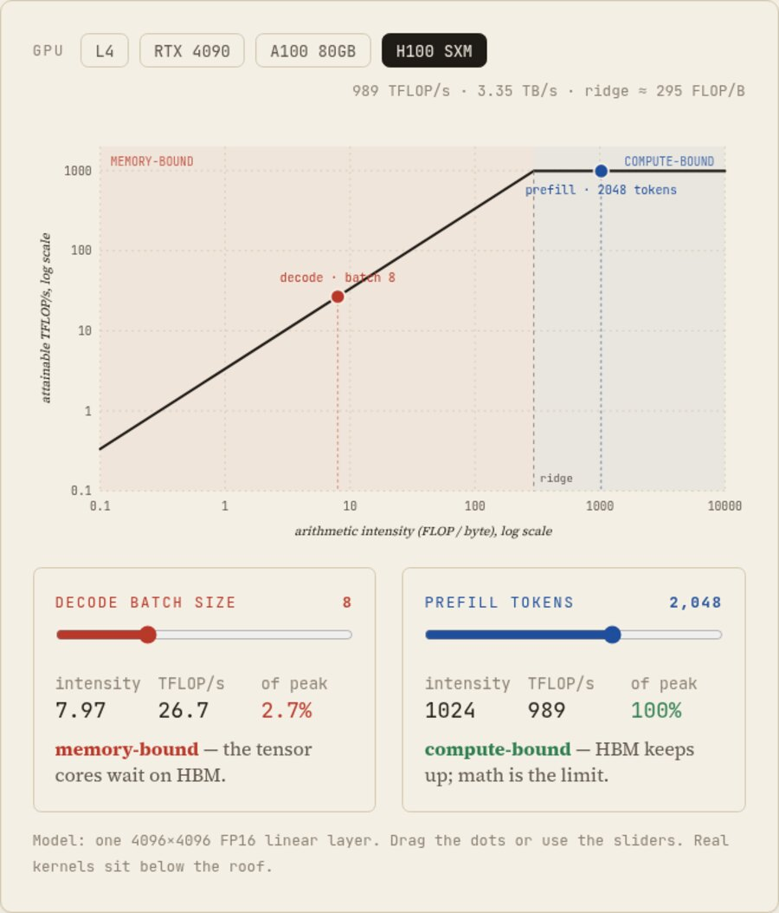
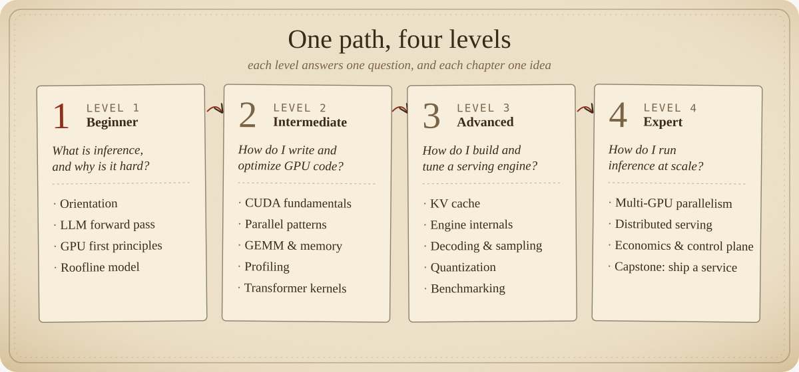
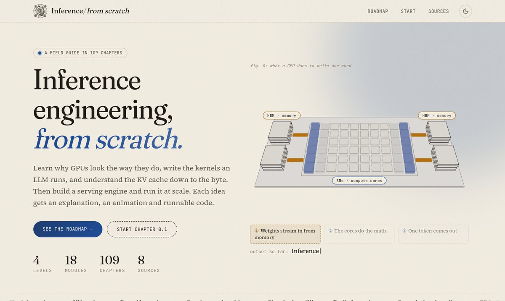

<p align="center">
  
</p>

<p align="center">
  <a href="./ROADMAP.md"><b>Roadmap</b></a> &nbsp;·&nbsp;
  <a href="./src/content/chapters/m00/what-is-inference-engineering.mdx"><b>Chapter 0.1</b></a> &nbsp;·&nbsp;
  <a href="./labs"><b>Labs</b></a> &nbsp;·&nbsp;
  <a href="#-built-on"><b>Sources</b></a>
</p>

<p align="center"><i>Why does a chatbot write one word at a time, and why is that the whole engineering problem?</i><br/>This course answers that, starting from zero.</p>

<p align="center">❦</p>

## ✎ See it

Every idea comes with something you can play with. This is chapter 0.2, which follows one request through a real inference server:

<p align="center">
  
</p>

<table>
  <tr>
    <td width="50%" valign="top">
      
      <p><b>9.1 · How big is the KV cache?</b><br/>Add users until the GPU runs out of memory.</p>
    </td>
    <td width="50%" valign="top">
      
      <p><b>3.3 · The roofline model</b><br/>Drag decode and prefill to see which one is memory-bound.</p>
    </td>
  </tr>
</table>

## ✎ What you'll learn

<p align="center">
  
</p>

By the end you can:

- **Explain** why decode is limited by memory bandwidth, not FLOPs, and do the arithmetic on paper.
- **Write** the GPU kernels an LLM runs: reductions, tiled matmul, attention, in CUDA and Triton.
- **Build and tune** a serving engine: PagedAttention, continuous batching, quantization, speculative decoding.
- **Scale** it out with prefill/decode disaggregation, KV-aware routing and cost-per-token math.

Full chapter list: **[ROADMAP.md](./ROADMAP.md)**

## ✎ How every chapter works

**Concept** → **Animation** → **Code lab** → **Sources** → **Quiz**

| Lab badge | Runs on |
|:--|:--|
| 🟢 CPU | Any laptop: Python + NumPy |
| 🟡 GPU optional | Laptop, or faster on a GPU |
| 🔴 GPU required | Your NVIDIA GPU, Colab/Kaggle (free T4), or a rented GPU |

All of Level 1 works without a GPU.

## ✎ Start in two minutes

Clone this repository, then:

```bash
npm install
npm run dev                            # → http://localhost:4321
```

Check what your machine can run:

```bash
pip install numpy
python labs/m00/0.3/check_env.py       # tells you which labs (🟢 🟡 🔴) work here
```

## ✎ Where it stands

This is an early, growing course:

- ✅ **Written:** 0.1 What inference engineering is · 0.2 The life of a request · 0.3 How to use the labs · 3.3 The roofline model · 9.1 How big is the KV cache?
- 📝 **Outlined:** the other 104 chapters, each with its sources already mapped.

## ✎ Built on

The course stands on these open resources and credits them in every chapter:

| | Source | Strongest at |
|:--|:--|:--|
| ⌥ | [BEFORE-GPU-ENGINEERING](https://github.com/BEFORE-GPU-ENGINEERING/BEFORE-GPU-ENGINEERING) | GPU architecture from first principles |
| ❖ | [100 Days of CUDA](https://pavelsimo.github.io/100-days-of-cuda/) | Kernels, from vector add to paged attention |
| ❖ | [time-to-first-token](https://github.com/patchy631/time-to-first-token) | Shipping and measuring a real vLLM service |
| ✎ | [LLM Inference at Scale](https://www.mohith.xyz/blog/llm-inference-at-scale) | KV-cache math and serving intuition |
| ✎ | [vLLM Router release](https://vllm.ai/blog/2025-12-13-vllm-router-release) | Routing and prefill/decode disaggregation |
| § | [From Inference Engine to Inference Control Plane](https://arxiv.org/abs/2609.23130v1) | The control layer: vLLM + llm-d |
| ❡ | *AI Systems Performance Engineering* (Chris Fregly) | GPU, CUDA and PyTorch performance |
| ✳ | [Akshay Pachaar on X](https://x.com/akshay_pachaar/status/2020840784782913605) | *(to be added)* |

## ✎ Write a chapter

1. Find the chapter's `module.id` and `slug` in [`src/data/roadmap.ts`](./src/data/roadmap.ts).
2. Create `src/content/chapters/<module>/<slug>.mdx`, using [`m09/kv-cache-size.mdx`](./src/content/chapters/m09/kv-cache-size.mdx) as the template.
3. Follow the arc: concept, then an interactive `<Figure>`, then a lab in `labs/`, then `<Sources>` and a `<Quiz>`.

<details>
<summary><b>Project layout</b></summary>

| Path | What |
|:--|:--|
| `src/data/roadmap.ts` | Single source of truth: levels → modules → chapters |
| `src/content/chapters/` | Chapter text (MDX) |
| `src/components/viz/` | Interactive figures |
| `labs/` | Runnable lab code, by module and chapter |
| `npm run roadmap` | Regenerates `ROADMAP.md` |

Built with Astro, React, Tailwind, Three.js, Motion and KaTeX.
</details>

<p align="center">❦</p>

<p align="center"></p>

<p align="center"><sub>Ink on paper · made for students who want to know what actually happens after you press Enter.</sub></p>
